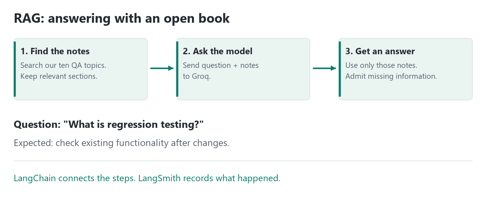
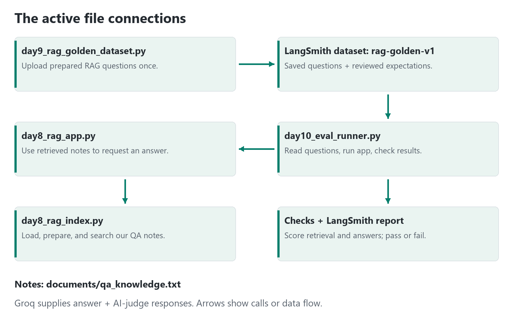

# Our First AI Quality Demo

**One sentence:** We built a small assistant that answers software-testing
questions from our notes, plus a system that checks its answers.

**Current implementation status:** See the
[Phase 2 requirement check](README.md#phase-2-requirement-check).
The evidence and slides below describe the earlier demo snapshot; the code now
has 30 offline tests, explicit evaluator callbacks, and strict `>` targets.
Groq remains the chosen provider because OpenAI API access is unavailable;
the instructor has approved this substitution for the course's `gpt-4o-mini` rule.

Start with sections 1-4. Use the file map when someone asks how the code fits
together. The appendix is a reference, not something to read aloud.

**Presentation:** [DEMO_SLIDES.pptx](DEMO_SLIDES.pptx), with 11 main slides,
5 optional reference slides, and speaker notes. The deck opens without Python.

## 1. Why Did We Build This?

A confident answer is not always a correct answer.

A new QA team member asks, **"What is regression testing?"** Our assistant
should explain that it checks existing functionality after changes. It should
not invent a promise such as "Regression testing guarantees zero bugs."

We want to check three things:

- Did it find the right information?
- Did it write a useful answer supported by that information?
- Did it admit when our notes do not contain the answer?

This is a learning project, not a finished production chatbot. The same approach
could later test a support or company-policy assistant using that team's notes.

## 2. The Names, Without the Jargon

| Term | Think of It As | What It Means Here |
| --- | --- | --- |
| **LLM**: large language model | A writer that has learned patterns from lots of text | Generates an answer; it can also make mistakes. |
| **Groq** | The service we contact to use the writer | Hosts our model, currently `openai/gpt-oss-20b`. Has usage limits. |
| **LangChain** | The connecting toolkit | Helps Python work with documents and send questions to the model. It is not the model. |
| **LangSmith** | The activity record and report book | Records what happened; stores test questions, experiments, and scores. It does not generate our answers. |
| **RAG**: retrieval-augmented generation | Answering with an open book | Find relevant notes first, then ask the model to answer using them. It is not model training. |
| **Evals**: evaluations | Checking and marking the work | Run prepared questions and assess the retrieved notes and answers. |
| **Framework** | A reusable checking process | Connect questions, answers, checks, and reports so we can repeat the process after changes. |

**Remember:** Groq supplies model responses. LangChain connects the parts.
LangSmith records and helps evaluate the work. They are different tools.

## 3. Picture the Two Jobs

**Job A: Answer a question.** This is the application.



**Job B: Check the application.** This is the evaluation framework.

```text
Prepared test questions ---> Run Job A for each question
                                      |
                                      v
                            Check notes AND answers
                                      |
                                      v
                         LangSmith report + pass/fail
```

LangChain helps connect these steps. LangSmith records the work. Some checks
are ordinary Python; the AI judge is another Groq request. Answering and judging
currently default to the same model, playing different roles. The judge can be
wrong too: its scores are estimates, not guaranteed truth.

**Chat versus RAG:** The earlier chat exercise asks the model directly.
The active RAG application looks up our notes first. Asking an assistant to use
notes reduces risk, but it does not guarantee a correct answer.

## 4. Follow One Question

**Question:** "What is regression testing?"

1. Our knowledge file contains the regression-testing explanation.
2. The index prepares the notes for meaning-based search, once at the start
   of the evaluation, not once for every question.
3. Retrieval selects likely relevant sections. Named topics help select
   comparison questions; weaker neighboring matches are filtered out.
4. The RAG application sends the question, selected notes, and instructions
   to Groq.
5. An expected answer is: "It checks that existing functionality still works
   after changes." Exact wording can differ.
6. Evaluators check the retrieved text and answer. LangSmith stores results.

**Another question:** "What is a senior QA engineer's salary?"
Our notes do not contain salaries. The expected RAG response is:
"I don't know based on the available knowledge."
Refusing that question is a success, not a failure.

## 5. How the Files Connect

This is the **active Day 10 path**, not a requirement to run every file in order:



The runner calls the RAG application. The application uses the index helpers.
The index loads the notes and retrieves chunks. The runner checks what came back.
LangChain libraries support these connections inside the code.

## 6. What Do the Scores Mean?

Scores usually range from 0 to 1. `0.80` is approximately 80% on that scoring
scale, **not necessarily 80% correct answers**. These are averages over applicable,
valid examples.

| Score | Plain Question | Example of a Problem | Pass Target |
| --- | --- | --- | --- |
| Context recall | Did we find the expected information? | Smoke-versus-sanity question is missing the smoke section. | At least 0.85 |
| Context precision | Are the retrieved notes relevant? | Selenium notes appear for a regression-only question. | At least 0.80 |
| Faithfulness | Does the answer stay supported by the notes? | It claims something the notes never say. | At least 0.90 |
| Hallucination rate | How much of the answer is unsupported? | It invents a salary figure. Lower is better. | Below 0.05 |
| No-answer rate | Does it refuse questions our notes cannot answer? | It guesses a price instead of admitting it does not know. | At least 0.95 |
| Answer relevance | Does it address the question asked? | Asked about API testing; answers about browser automation. | At least 0.80 |

Python checks expected context phrases and refusal wording. The AI judge
estimates the other four scores. Not every stored expected-answer field is
checked by Day 10; the judge does not receive the reference answer. Human review
is still important. All required targets must pass, with no recorded generation
or judge errors. Strong scores cannot cancel a quota failure.

## 7. Offline Versus Live

| Check | What Happens | What It Proves |
| --- | --- | --- |
| Offline unit tests | Use controlled or pretend model responses. No Groq requests. | The tested code handles scores, retries, retrieval selection, and errors as expected. |
| Offline retrieval check | Search actual QA notes with the cached local embedding model. No Groq requests. | Expected phrases were retrieved; not answer quality. |
| Live evaluation | Generate real answers and AI judgments through Groq; save the experiment in LangSmith. | Whether that run meets the quality targets with the chosen data and model. |

Running on your laptop does **not** make a run offline.
`python day10_eval_runner.py` still contacts Groq and LangSmith.

**Current evidence:** 19 offline tests pass. Local retrieval phrase recall is
99.29% on 47 applicable examples out of 56. The latest full live run is pending.
The previous run hit Groq's daily token quota and had precision 0.7954 against
a 0.80 target, before our latest retrieval refinement.

Quota exhaustion means the service cannot complete requests within its allowance.
It does not prove a wrong answer, but prevents a complete pass claim. Say:
**"Implementation is in place; full live quality validation is pending."**
GitHub CI does not provide a separate Groq allowance.

## 8. Setup and a Short Demo

You need Python 3.12, the project packages, the QA notes, and internet access.
You also need Groq and LangSmith accounts with private API keys, a saved
`rag-golden-v1` dataset, and sufficient Groq quota for live evaluation.
The embedding model downloads once, then runs locally.

Initial PowerShell setup:

```powershell
py -3.12 -m venv .venv
.\.venv\Scripts\Activate.ps1
python -m pip install -r requirements.txt
```

Configure the private `.env` using the template: `GROQ_API_KEY`,
`LANGSMITH_API_KEY`, `LANGSMITH_TRACING=true`, and `LANGSMITH_PROJECT`.
Enter keys privately; never show them in slides or chat. If the RAG dataset is
missing, upload the reviewed examples once with
`python day9_rag_golden_dataset.py`. Do not re-upload just for a demo.
GitHub CI needs those keys in Actions secrets, not committed source code.

**A 10-minute presentation:**

1. Explain the purpose and the six main terms in sections 1-2.
2. Follow the regression question through the picture in sections 3-4.
3. Open the knowledge file, index, RAG app, and runner, in that order.
4. Run offline tests, then show a saved LangSmith question, sources, answer,
   and scores. Label it a recorded run, not a fresh successful result.
5. Close with what passed and what is still pending.

Safe demo command; no model quota used:

```powershell
python -m unittest test_day10_eval_runner.py
```

Only with sufficient quota, the full live command is:

```powershell
python day10_eval_runner.py
```

**Takeaway:** The application answers the question. The framework checks the
answer. LangSmith makes the evidence visible. Humans decide whether the evidence
is good enough.

## Appendix A: Every Python File

"Without it" means without its role or a replacement for it.

| File | Its Job and Connection | What We Lose Without It |
| --- | --- | --- |
| [day10_eval_runner.py](day10_eval_runner.py) | Main evaluation coordinator: reads saved RAG questions, calls the RAG app, runs checks, and decides pass/fail. | No automated end-to-end RAG quality run or threshold gate. |
| [day8_rag_app.py](day8_rag_app.py) | Active RAG assistant: calls index helpers, builds the prompt, requests an answer, and retries temporary limits. | No active question-to-grounded-answer flow; the runner cannot call it. |
| [day8_rag_index.py](day8_rag_index.py) | Librarian: loads notes, splits topics, creates local embeddings, and retrieves sections. | The RAG app cannot search our notes. |
| [day9_rag_golden_dataset.py](day9_rag_golden_dataset.py) | Defines 56 reviewed RAG examples; uploads missing cases to `rag-golden-v1`. | No local RAG test-set definition/uploader. An already uploaded dataset can still be used. |
| [test_day10_eval_runner.py](test_day10_eval_runner.py) | Offline tests of retrieval, retries, judge handling, and pass/fail logic using controlled substitutes. | Less protection against bugs in the checker. Does not replace live AI tests. |
| [day6_chat_app.py](day6_chat_app.py) | Earlier interactive chat exercise. Calls Groq directly and records traces, without retrieving QA notes. | No direct-chat demo; Day 10 RAG still works. |
| [day7_evaluators.py](day7_evaluators.py) | Earlier keyword and AI relevance checks, using its own starter dataset `qa-chat-golden-dataset`. | No starter eval demo. Day 10 has its own evaluators and does not import it. |
| [day9_golden_dataset.py](day9_golden_dataset.py) | Defines and uploads 30 general-chat examples to `chat-golden-v1`. | No chat test-set source/uploader. Day 10 uses the separate RAG dataset. |
| [day8_trace_check.py](day8_trace_check.py) | Sends a small trace to check LangSmith connectivity; does not call an LLM. | No dedicated tracing smoke check; main app still exists. |
| [day8_rag_app_backup.py](day8_rag_app_backup.py) | Older RAG version kept as a backup; not imported by the active runner. | No effect on active Day 10. Do not demonstrate it as the current implementation. |

## Appendix B: Other Files and Supporting Words

| File / Folder | Why It Exists; What Happens Without It |
| --- | --- |
| [documents/qa_knowledge.txt](documents/qa_knowledge.txt) | Ten QA reference topics. Without it, the current index has no knowledge source to load. |
| [requirements.txt](requirements.txt) | Lists application packages. Without it, setup is harder to reproduce. |
| [.env.example](.env.example) | Configuration template, not working credentials. Without it, new users have less setup guidance. |
| Local `.env` | Private keys/settings, excluded from Git. Without it, settings must come from the environment another way. Never display it. |
| [.gitignore](.gitignore) | Excludes private/generated files from normal Git tracking. Without it, accidental commits are more likely. |
| [.github/workflows/rag-evaluation.yml](.github/workflows/rag-evaluation.yml) | GitHub Actions instructions. Without it, local runs still work but those automated GitHub checks do not run. |
| [day8_manual_tests.md](day8_manual_tests.md) | Historical human test scenarios/results. Without it, we lose the manual record, not executable code. |
| [README.md](README.md) | Setup and operational reference. Without it, less guidance for installing and running. |
| [DEMO_GUIDE.md](DEMO_GUIDE.md) | This explanation. Without it, code still works but the walkthrough is missing. |
| [DEMO_SLIDES.pptx](DEMO_SLIDES.pptx) | Editable presentation with speaker notes. Not required by the app. |
| [demo_assets/answer_flow.png](demo_assets/answer_flow.png), [demo_assets/file_map.png](demo_assets/file_map.png) | Original diagrams used here and embedded in the slides. Without them, the guide loses its pictures, not its application behavior. |
| [tools/build_demo.py](tools/build_demo.py) | Optional slide/diagram generator. Not imported by the application; without it, the existing deck still opens. |
| `.venv/`, `__pycache__/`, `.git/` | Installed environment, disposable Python cache, and version history. Without them, packages need reinstalling, cache regenerates, or local Git history is lost, respectively. Do not delete these for the demo. |

To regenerate presentation assets only, install `python-pptx` in a separate
tools environment and run `python tools/build_demo.py`. These optional tools
are not needed to run the application or open the deck.

| Word | Plain Meaning | Small Example |
| --- | --- | --- |
| Knowledge base / KB | Our reference notes | The ten QA topics. |
| Chunk | One piece of those notes | The regression-testing section. |
| Embedding | Numbers used to compare meaning | Helps match "old features after a fix" with regression testing. |
| Vector store / index | A searchable collection of representations and notes | Finds likely relevant sections; not an answer database. |
| Context | Notes supplied with a question | The regression section sent to the model. |
| Prompt | Instructions sent to the model | "Answer using only these notes." |
| Golden dataset | Prepared questions with reviewed expectations | A smoke-versus-sanity comparison and its expected concepts. |
| Judge / evaluator | A checker | Python checks phrases; an AI judge estimates quality. |
| Trace | Record of one request's steps | Retrieved notes and the generated answer. |
| Experiment | One batch of evaluated questions | A run of the 56 RAG examples. |
| API / API key | A way to contact a service / a private access credential | Python contacts Groq using a key. Never show it. |
| Token / quota | A small unit of model text / a usage allowance | Generating and judging both consume quota; tokens are not exactly words. |
| CI | Automated checks on GitHub | GitHub Actions can run tests and live evaluation. |