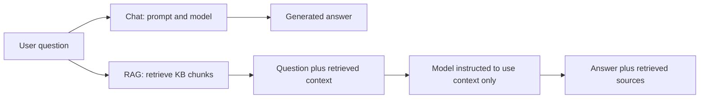
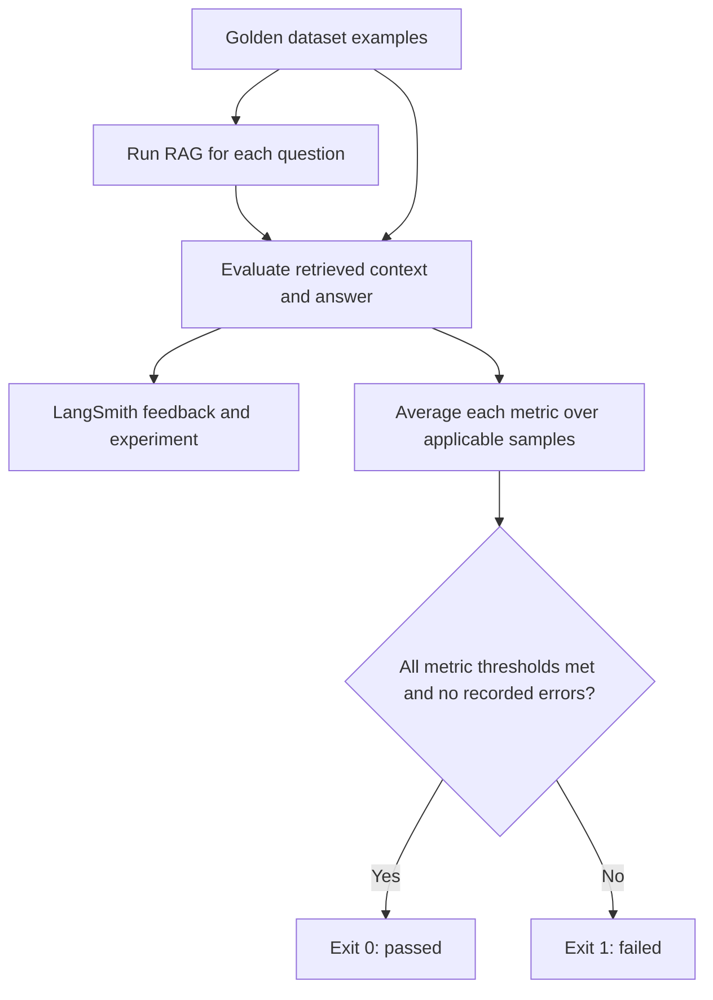

# Phase 2 Team Demo: Testing AI Answers With LangSmith

Audience: QA engineers and team members new to Python and AI application testing.
Suggested duration: 30 minutes, followed by questions.
Scope: Phase 2, Days 6-10. Phase 1 Playwright is background, not part of this application.

## 1. Your Opening: What Did I Build?

Say:

> In Phase 1, we tested whether a web application behaved correctly. In Phase 2,
> we test whether an AI application's answers are useful, supported by evidence,
> and safe to trust. I built a QA chatbot, a knowledge-grounded assistant, and an
> evaluation pipeline. LangSmith helps us see what happened inside each run;
> GitHub Actions runs checks when the code changes.
>
> This is my first implementation of these concepts. I will show both what
> works and what is still incomplete, rather than present it as a production-ready system.

The application answers questions about software testing. The framework tests
that application. They are two different things in the same repository.

| Part | Purpose | Example |
| --- | --- | --- |
| Chat application | Ask an LLM a question directly | Explain regression testing |
| RAG application | Find relevant KB text before asking the LLM | Explain regression testing using our QA knowledge |
| Evaluation framework | Check the application's answers and retrieval | Was the answer supported? Were the right topics retrieved? |
| CI workflow | Automatically run the checks | Mark a GitHub job failed if evaluation fails |

Business use: the same pattern could test a support assistant, internal policy
assistant, or product documentation assistant. Those would need their own
approved knowledge, datasets, security controls, and acceptance criteria.

## 2. Begin With Familiar QA Concepts

| Phase 1: Playwright | Phase 2: This Project |
| --- | --- |
| UI input and user actions | Questions and prompts |
| DOM and page state | Retrieved documents and generated answers |
| Expected UI behavior | Expected facts, relevant context, or correct refusal |
| Test case file | Golden dataset |
| Assertion | Evaluator |
| Playwright execution trace | LangSmith execution trace |
| Test report | LangSmith experiment results |
| Regression run in CI | AI evaluation run in CI |

Say:

> The manual-first discipline stays the same: understand expected behavior,
> try representative cases, review the checks, and only then automate them.
> The difference is that multiple wordings can be correct, so exact string
> equality is often not enough for AI answers.

Some AI checks are deterministic, such as finding a phrase. Others require
human judgment or an LLM-based estimate. Even temperature 0 does not guarantee
identical answers or identical scores across all runs and model updates.

## 3. Explain the Tools Without Assuming Prior Knowledge

| Term | Plain-Language Meaning | Role Here |
| --- | --- | --- |
| Python | A programming language used to write executable instructions | Connects retrieval, model calls, evaluators, and reports |
| Script | A file containing those instructions | `python` runs a selected entry point |
| Function | A named, reusable operation | `run_rag` handles one question |
| Library/package | Reusable code written by others | LangChain integrations, LangSmith SDK, and embedding tools |
| Virtual environment | A project's isolated collection of installed packages | Avoids mixing dependencies between projects |
| API | A way for software to request a service | Python requests model responses from Groq |
| API key | A credential authorizing those requests | Stored privately, not in committed source |
| LLM | Large language model: a model that generates language | Produces answers and judges subjective quality |
| Model provider | The service hosting a model | Groq in the current implementation |
| Prompt | Instructions and information sent to a model | Question, retrieved knowledge, and response rules |
| Token | A unit used by the model to process text; not exactly one word | Affects cost, context capacity, and quota |
| Temperature | A model setting that influences sampling variability | Set to 0 to reduce variability |
| LangChain | Libraries and integrations for connecting AI application components | Model wrappers, messages, documents, and vector-store APIs |
| LangSmith | A platform and SDK for observing and evaluating AI applications | Traces, datasets, feedback, and experiments |
| JSON | A structured data format with named fields | The combined judge returns named numeric scores |
| Git | Version control for tracking code revisions | Records commits and branches locally |
| GitHub | Hosts the Git repository and collaboration workflow | Pull requests and Actions |
| CI | Continuous integration: automated checks on code changes | Offline tests and live RAG evaluation |

Say:

> Groq generates the answer. LangChain helps my Python code communicate with
> the model and retrieval components. LangSmith records and evaluates the run.
> These are different responsibilities, not three names for the same AI model.

The provided learning plan requires every LLM call to use `gpt-4o-mini` through
OpenAI. This repository currently uses Groq's `openai/gpt-oss-20b`, which is a
different model. Present this as a deviation that needs instructor/team approval
or migration, not as compliance with that requirement. The `openai/` portion
of Groq's model ID does not mean the code uses the OpenAI API or `gpt-4o-mini`.

## 4. The Two Application Flows



Chat relies on the model's learned knowledge and instructions. It does not look
up this project's QA knowledge file. It can answer general questions, but that
does not make every answer reliable or current.

RAG means Retrieval-Augmented Generation. It supplies relevant knowledge at
request time before generating the answer. It is not training or fine-tuning
the model. A prompt restriction reduces risk but does not guarantee grounding.

Analogy: Chat answers from memory; RAG takes an open-book approach. We still
test whether it opened the right pages and whether its answer follows them.

## 5. RAG Internals: Indexing, Retrieval, Generation

Open [documents/qa_knowledge.txt](documents/qa_knowledge.txt), then
[day8_rag_index.py](day8_rag_index.py) and [day8_rag_app.py](day8_rag_app.py).

### Indexing: Prepare the Knowledge

1. Load the QA knowledge file from disk.
2. Split it at Markdown topic headers using `MarkdownHeaderTextSplitter`.
3. Keep source and section metadata with each chunk.
4. Convert the chunks into numeric embeddings using `all-MiniLM-L6-v2`.
5. Store the embeddings and text in `InMemoryVectorStore`.

A chunk is a piece of text. An embedding is a numeric representation that
helps compare meaning. A vector store searches those representations rather
than only checking exact keywords.

Current knowledge: 10 topics, including manual, regression, automation, API,
smoke and sanity testing, bug life cycle, test cases, severity/priority, and Selenium.
The current splitter produces 10 topic chunks. The earlier Day 8 manual report
describes an older six-chunk, fixed-size setup; explain that it is historical.

The embedding model runs locally after it is downloaded from Hugging Face.
It is different from the answer-generating LLM. The in-memory index is rebuilt
when the process starts and is not a persistent production database.

### Retrieval: Find Likely Relevant Knowledge

1. Embed the user's question.
2. Compare it with the stored chunk embeddings.
3. Retrieve up to three candidate chunks and similarity scores.
4. Prefer candidates whose section keywords are explicitly mentioned in the
    question, ignoring topic words directly following `without`.
5. If no section matches, keep candidates within 0.05 of the strongest score.

`k=3` is the maximum candidate count, not a guarantee of three relevant results.
Section matching preserves named topics for comparison questions; the fallback
score filter removes weaker matches. This is a heuristic, not a reranker or an
absolute relevance cutoff: an out-of-KB question can still retrieve chunks
that do not contain its answer. Similarity is not a probability that the
final answer is correct.

### Generation: Answer From the Retrieved Context

1. Join the retrieved text into a context block.
2. Include that context and the question in a prompt.
3. Instruct the model to use only the supplied knowledge.
4. Request a fixed refusal when the answer is unavailable.
5. Return `answer`, `retrieved_sources`, and `retrieved_count` for evaluation.

The requested refusal is: `I don't know based on the available knowledge.`
Sources are exposed in the function output for inspection, not guaranteed
inline citations in the generated answer.

## 6. Day 6: Make the Execution Visible

Open [day6_chat_app.py](day6_chat_app.py) and locate `@traceable`.

Say:

> A trace is the execution history of one request. A child run or span shows
> an operation inside it, such as retrieval or a model call. Feedback is our
> judgment of its quality. Visibility and correctness are separate: a trace
> tells us what happened, not automatically whether it was good.

| LangSmith Concept | What to Point Out |
| --- | --- |
| Project | A grouping of related traces; local config currently names the Day 8 project |
| Trace | One end-to-end chat or RAG request |
| Child run/span | Retrieval, generation, or model invocation |
| Inputs/outputs | Question, prompt, context, and generated response |
| Tags | Labels used for filtering |
| Metadata | Extra fields, such as session ID or dataset category |
| Feedback | Human or automated score and comment |
| Experiment | One evaluation run against a dataset |

In LangSmith, show an existing chat trace, then a RAG trace. Expand
`rag-question-answering` to inspect `rag-retrieval` and `rag-generation`.
Indexing is a separate traced setup operation called before question answering,
not necessarily a child of every question trace.

The chat entry point retains Day 8 labels even though its file is named Day 6.
Its session ID is metadata; it does not implement stored conversational memory.
The Day 7 starter target also calls a model directly rather than invoking this
interactive chat function, so do not claim both use identical prompts.

Show or attach a human feedback score only if you have actually done so. Do
not describe a required learning activity as completed based on a code decorator.

## 7. Day 7: Turn Expectations Into Evaluators

Open [day7_evaluators.py](day7_evaluators.py).

An evaluator is a function that receives the actual run and a reference example,
then returns a metric key, score, and optional explanation.

| Evaluator | What It Checks | Additional LLM Call? | Limitation |
| --- | --- | --- | --- |
| `keyword_coverage` | Required phrases found in the answer | No | Equivalent wording may be missed; wrong text can contain the right words |
| `hallucination_check` | Configured forbidden phrases found | No | Does not detect every unsupported fact and does not understand negation |
| `llm_relevance` | Whether the answer addresses the question | Yes | The judge can make mistakes and needs calibration |

Manual-first demonstration: use a good answer, a bad answer, and an edge case.
Ask the audience what scores they expect before revealing the result.

Example with two required phrases, `existing functionality` and `code changes`:

| Response | Keyword Score | Discussion |
| --- | --- | --- |
| Checks existing functionality after code changes | 1.0 | Both required phrases appear |
| Only checks newly added features | 0.0 | Neither required phrase appears; the answer is also misleading |
| Checks existing functionality after modifications | 0.5 | May be acceptable wording even though one exact phrase is missing |

This is evaluator calibration, not proof that the keyword score measures truth.
For a forbidden phrase `guarantees zero bugs`, even the safe sentence
`Regression testing never guarantees zero bugs` is flagged by a substring check.
That false positive is a useful example of why humans must review evaluator logic.

The starter script uses `qa-chat-golden-dataset`, with three starter examples
when newly created. It does not automatically switch to the larger Day 9 chat dataset.

## 8. Day 8: Establish Behavior Manually

Open [day8_manual_tests.md](day8_manual_tests.md).

Explain the six scenarios: supported question, out-of-domain question, ambiguous
question, adversarial instruction, empty input, and very long input.
Each was considered for both Chat and RAG. The report records 12 historical
manual passes; that is not a fresh validation of today's code or model.

Explain one important difference: Chat can use general learned knowledge for
an out-of-domain question. RAG should not invent an answer absent from its KB.
The same input can therefore have different expected behavior in the two apps.

The active chat function checks empty and oversized input. The active RAG
functions do not currently implement matching validation or truncation.
The RAG backup contains an interactive loop, but it is not the active module
used by the Day 10 runner. Avoid demonstrating the backup as the current app.

## 9. Day 9: Build a Golden Dataset

Open [day9_golden_dataset.py](day9_golden_dataset.py) and
[day9_rag_golden_dataset.py](day9_rag_golden_dataset.py).

Say:

> A golden dataset is our reviewed collection of representative questions and
> expectations. It includes more than easy happy paths. We use the same cases
> repeatedly to detect regressions. These are evaluation examples, not training data.

| Dataset | Local Example Count | Purpose |
| --- | --- | --- |
| `chat-golden-v1` | 30 | General chat quality cases |
| `rag-golden-v1` | 56 | Retrieval, grounding, refusal, ambiguity, adversarial, and multi-topic cases |

Inspect the existing LangSmith datasets to confirm current cloud counts; they
could differ from the local definitions if somebody changed the cloud dataset.
The project records the examples as human approved, and upload checks the
verification fields. A flag alone cannot prove a person actually reviewed an example.

Explain a RAG example's fields:

| Field | Meaning |
| --- | --- |
| `question` | Input sent to the application |
| `answer` | Human-reviewed reference expectation, not necessarily exact required wording |
| `required_keywords` | Expected concepts for checks that use those fields |
| `expected_context_contains` | Phrases expected in retrieved context |
| `min_retrieved_docs` | Stored retrieval expectation |
| `category` and `difficulty` | Labels supporting coverage and targeted review |
| `human_verified` | Recorded human approval during upload |
| `case_id` | Stable ID used to avoid duplicate uploads |

Important: the current Day 10 runner uses context phrases and category, but
does not directly check every stored reference field. It does not enforce
`min_retrieved_docs` or `required_keywords`, and its combined judge does not
receive the stored expected answer. Dataset richness and evaluator coverage
are related but are not automatically the same.

The uploaders skip existing case IDs rather than updating changed examples.
Changing a local reference does not automatically replace its cloud version.
Also, a `v1` name by itself does not pin an immutable dataset snapshot.

## 10. Day 10: Evaluate Retrieval and Answers Together

Open [day10_eval_runner.py](day10_eval_runner.py).



The curriculum asks for four evaluators: recall, faithfulness, hallucination,
and answer relevance. This implementation covers those quality areas using
three callbacks: context recall, a combined LLM judge returning four metrics,
and out-of-scope refusal. It reports six metric keys. This is not literally
four separate evaluator functions.

| Metric | Question It Answers | Current Implementation | Current Gate |
| --- | --- | --- | --- |
| Context recall | Did we retrieve the expected information? | Fraction of expected phrases found in retrieved text | >= 0.85 |
| Context precision | Is the retrieved information relevant? | LLM judge estimate | >= 0.80 |
| Faithfulness | Are the answer's claims supported by context? | LLM judge estimate | >= 0.90 |
| Hallucination rate | How much of the answer is unsupported? | LLM judge estimate | < 0.05 |
| No-answer rate | Did it correctly refuse an out-of-KB question? | Refusal-phrase check on `out_of_scope` examples only | >= 0.95 |
| Answer relevance | Does it address the question? | LLM judge estimate | >= 0.80 |

The learning plan writes strict `>` targets for several metrics; the current
runner uses `>=` for higher-is-better metrics. Call this out if exact acceptance
criteria are being reviewed. Hallucination is lower-is-better, so its direction differs.

Recall here is a phrase-coverage proxy, not a complete document-recall measure.
Precision is not a deterministic count of human-labeled relevant chunks.
Faithfulness is not the same as truth: an answer can follow a flawed KB faithfully.
Relevance is not the same as correctness: an on-topic answer can still fabricate facts.
The refusal check recognizes phrases, not whether the entire response safely abstains.

The judge reads question, context, and answer, then returns JSON with four
scores. Combining metrics reduces judge calls, but does not eliminate judge
bias. App and judge currently default to the same model. Review samples with
humans before treating high scores as reliable acceptance evidence.

The runner checks each metric separately; strong relevance cannot cancel a
failed hallucination threshold. Non-applicable scores are not included in
the corresponding metric average. Missing required metrics fail the gate.
With only six out-of-scope examples in the local RAG dataset, one refusal failure
produces about 0.833, below the 0.95 threshold; sample size matters.

The code has a reusable `main(dataset_name, limit)` entry point and CLI options.
It does not currently implement the curriculum's `EvalConfig` dataclass and
`RAGEvalRunner` class abstraction. It resets global score state between runs;
it is not designed as a concurrent multi-experiment service.

## 11. Explain the Results We Actually Observed

| Evidence | What You Can Claim | What You Cannot Claim |
| --- | --- | --- |
| 10 offline regression tests passed | Covered runner/retry behaviors passed using controlled mocks | All real AI answers are correct |
| Three-example diagnostic run, no provider errors | Generation, judging, and reporting worked for those samples | The full dataset passed |
| `no_answer_rate: N/A` on that subset | No applicable refusal sample was evaluated | Refusal behavior is perfect or broken |
| Full local and GitHub run returned Groq 429 | Provider quota prevented complete evaluation; failure reached CI | The shown low scores measure real model quality |
| GitHub Offline Tests passed, Quality Gate failed | CI execution and failure propagation are demonstrated | Branch rules necessarily blocked merging |

Say:

> The three-example run gave good scores for the measured metrics, but it
> had no out-of-scope examples. The full run was blocked by provider quota.
> That demonstrates failure handling, not a completed quality assessment.
> I will not hide the failure by lowering thresholds or counting missing data as a pass.

The current runner may record recall/refusal zeros for failed outputs and repeat
the stored quota error for remaining examples. Its target error count can also
under-report cases skipped after the quota flag was set. Treat that experiment
as an infrastructure-blocked run, not a baseline. Improving that reporting is
a known follow-up, not something this demo claims is fixed.

## 12. GitHub Actions: From Local Tests to CI

Open [.github/workflows/rag-evaluation.yml](.github/workflows/rag-evaluation.yml)
and the existing [GitHub Actions runs](https://github.com/Jeavio-Kajol/langsmith-qa-learning/actions).

Explain the sequence: checkout code, set up Python 3.12, install dependencies,
run offline tests, verify secrets, run the full RAG evaluation, and retain logs.
The live job uploads its log even when evaluation fails.

Offline tests run for main pushes, PRs to main, manual dispatches, and weekly
runs. The live quality gate runs for PRs, manual dispatches, and Mondays at
06:00 UTC, not main pushes. Fork PRs do not receive repository secrets.

An exit code is how a program reports success or failure to its caller:
`0` means success; `1` means failure for this runner. GitHub marks a job failed
when the evaluation command returns 1. Branch protection must require that
check for it to prevent merging. Our PR was merged; do not claim a merge was blocked.

The GitHub runner uses the same configured model provider and organization
quota as local requests using that organization. Moving a run to CI does not
give it a new independent Groq token allowance.

## 13. Your 30-Minute Presentation Order

| Minutes | Screen | Talking Point |
| --- | --- | --- |
| 0-3 | Opening and Phase 1/Phase 2 comparison | We are testing answers, not browser elements |
| 3-6 | Tool glossary and architecture diagram | Separate Python, LangChain, Groq, and LangSmith |
| 6-11 | KB, indexing code, active RAG functions | Index, retrieve, generate; RAG is not training |
| 11-15 | Existing LangSmith chat and RAG traces | Find the evidence behind an answer |
| 15-19 | Manual matrix and one golden example | Human review defines expected behavior |
| 19-23 | Evaluator code and a diagnostic experiment | Explain scores, applicability, and judge limitations |
| 23-27 | Offline tests and existing GitHub run | Automated failure propagation, including quota errors |
| 27-30 | Completion status and next steps | What is demonstrated versus still outstanding |

### Pre-Demo Checklist

1. Close the private environment file and clear secret selections before screen sharing.
2. Rotate exposed credentials and update local/GitHub settings privately; do not show key values.
3. Open the guide, KB, key code files, existing LangSmith traces/datasets, and Actions result in advance.
4. Use a working Python environment. CI uses Python 3.12; earlier local runs used global Python 3.15.
5. Confirm Groq capacity before attempting live model calls; one tiny successful request does not prove full-run capacity.
6. Keep screenshots or existing traces as a fallback. Label them as recorded evidence, not a fresh live run.
7. Avoid uploading datasets or running the full evaluator merely to fill presentation time.

### Demo A: Offline Tests, Safe From Model Quota

```powershell
python -m unittest test_day10_eval_runner -v
```

Open [test_day10_eval_runner.py](test_day10_eval_runner.py). Explain a mock as a
controlled substitute for an external service: we deliberately simulate success,
quota exhaustion, and failure without spending model tokens. These tests cover
gates, state reset, retry behavior, malformed/absent target output handling as
tested, and diagnostic limits; they do not replace live quality evaluation.

### Demo B: Calibrate the Keyword Evaluator Without Calling a Model

This imports the configured Day 7 module, but only calls its local keyword function.
It needs installed dependencies and valid local configuration; no model request is made.

```powershell
@'
from types import SimpleNamespace
from day7_evaluators import keyword_coverage

example = SimpleNamespace(outputs={
    "required_keywords": ["existing functionality", "code changes"]
})
answers = {
    "good": "Checks existing functionality after code changes.",
    "bad": "Only checks newly added features.",
    "edge": "Checks existing functionality after modifications.",
}
for label, answer in answers.items():
    result = keyword_coverage(SimpleNamespace(outputs={"output": answer}), example)
    print(label, result)
'@ | python -
```

Ask the team why the edge case might deserve a human review despite the 0.5 score.

### Demo C: Chat, Only With Available Model Quota

```powershell
python day6_chat_app.py
```

Ask `What is regression testing?`, inspect the response, then type `exit`.
In LangSmith, inspect the input, output, model child run, and session metadata.
Do not assume a new response matches a historical screenshot word for word.

### Demo D: Active RAG Functions, Only With Available Model Quota

Running `python day8_rag_app.py` alone does not start an interactive app:
the current file defines functions without a command-line loop. Use this
short invocation of the actual functions instead:

```powershell
@'
from day8_rag_app import build_knowledge_index, run_rag

index = build_knowledge_index()
questions = [
    "What is regression testing?",
    "What is the salary of a senior QA engineer in India?",
]
for question in questions:
    result = run_rag(question, index)
    print("Question:", question)
    print("Answer:", result["answer"])
    print("Retrieved chunks:", result["retrieved_count"])
    for source in result["retrieved_sources"]:
        print("Source:", source)
'@ | python -
```

Expected behavior: a supported explanation for regression testing and a refusal
for salary information, which the KB does not contain. These are expectations,
not promised live results. If retrieval still returns three chunks for salary,
explain why top-k retrieval and answerability are separate decisions.

### Demo E: Evaluation and Existing Results

Only when quota permits:

```powershell
python day10_eval_runner.py --limit 3
```

Show the experiment URL, metric averages, applicable sample counts, and exit
status. The subset uses the first N cloud-returned examples; it is not a fixed,
stratified sample and may again have no refusal cases. Explain a `NO VALID DATA`
gate honestly. Otherwise show the recorded diagnostic experiment instead.

The full command is `python day10_eval_runner.py`, but reserve it for a planned
evaluation with sufficient capacity, not an improvised demo. With 56 examples,
there can normally be 56 answer calls plus 56 combined judge calls, before retries.
The deterministic recall/refusal evaluators do not add LLM calls.

### If Groq Fails During the Demo

Say:

> The provider rejected this request because of quota. We have not obtained
> valid answer-quality evidence from that request. I will switch to the existing
> trace and offline tests so we can still inspect the architecture and failure handling.

Do not repeatedly rerun the full dataset or substitute a different model without
calling out the changed experiment conditions. Use the saved Actions log to show
that infrastructure failures correctly produce a red CI job.

## 14. File Tour: What Each File Is For

| File | Responsibility |
| --- | --- |
| [day6_chat_app.py](day6_chat_app.py) | Interactive traced QA chat; input validation and session metadata |
| [day7_evaluators.py](day7_evaluators.py) | Starter direct-model target, keyword/forbidden/relevance checks, starter dataset |
| [day8_rag_index.py](day8_rag_index.py) | Load KB, split topics, embed, index, and similarity search |
| [day8_rag_app.py](day8_rag_app.py) | Active traced RAG functions and Groq retry handling |
| [day8_rag_app_backup.py](day8_rag_app_backup.py) | Historical backup with a CLI; not the Day 10 target |
| [day8_trace_check.py](day8_trace_check.py) | Small LangSmith connectivity/tracing check |
| [day8_manual_tests.md](day8_manual_tests.md) | Historical Chat/RAG manual test observations |
| [day9_golden_dataset.py](day9_golden_dataset.py) | 30 chat reference examples and uploader |
| [day9_rag_golden_dataset.py](day9_rag_golden_dataset.py) | 56 RAG reference examples, validation, and uploader |
| [day10_eval_runner.py](day10_eval_runner.py) | RAG evaluation callbacks, summaries, per-metric gate, and CLI |
| [test_day10_eval_runner.py](test_day10_eval_runner.py) | 10 offline tests using controlled service substitutes |
| [documents/qa_knowledge.txt](documents/qa_knowledge.txt) | Source knowledge used by RAG |
| [requirements.txt](requirements.txt) | Python dependency versions |
| [.env.example](.env.example) | Configuration template without real keys |
| [.gitignore](.gitignore) | Excludes private configuration and generated files from Git |
| [.github/workflows/rag-evaluation.yml](.github/workflows/rag-evaluation.yml) | GitHub CI triggers, jobs, and log artifact |
| [README.md](README.md) | Setup, usage, proposed regression strategy, and completion requirements |

Private environment configuration stays local. GitHub stores equivalent secret
values in repository Actions secrets. Neither should be shown during a demo.

## 15. Honest Completion Status and Next Steps

Based on project code and the results observed in this learning session:

| Area | Status to Present |
| --- | --- |
| Chat/RAG implementation and tracing | Implemented; existing traces/manual observations provide evidence |
| Golden dataset definitions/uploaders | Implemented; verify current LangSmith records during the demo |
| Offline runner tests | 10 passed locally; GitHub Offline Tests passed in the shown run |
| Small live diagnostic evaluation | Worked for three samples; refusal coverage missing in that subset |
| Live CI failure handling | Demonstrated using provider quota exhaustion |
| Full valid quality evaluation and baseline | Not yet established; latest full run was quota blocked |
| Required branch protection checks | Must be verified in GitHub; workflow failure alone does not prove enforcement |
| LangSmith dashboards and metric alerts | Not provisioned by repository; account configuration remains to be verified/completed |
| Regression strategy | Proposed in README; team agreement and automated baseline comparison are not established |
| Literal curriculum compliance | Groq model, callback organization, runner abstraction, and boundary targets differ from the supplied plan |

Recommended next steps: agree on the model requirement, establish enough provider
capacity, calibrate judge/check logic, repair infrastructure-error reporting,
complete a valid full run, record an approved baseline, verify branch rules,
configure monitoring, and have the team approve the regression policy.

The intended dashboard charts correspond to the six feedback keys. Compare
experiments over time and alert on the same agreed thresholds where supported
by the LangSmith plan. A dataset experiment view is not by itself a configured
dashboard with alerts. Provider-error alerts should be separate from quality alerts.

Changing a model, prompt, retrieval setting, or KB can cause a regression.
The current workflow runs the full dataset on its live triggers, but does not
automatically enforce the curriculum's 5% baseline or 3% weekly comparisons.
Agree whether those mean relative percentages or percentage points before implementation.

## 16. Questions the Team May Ask

**Does RAG eliminate hallucinations?**
No. It supplies evidence and instructions; retrieval and generation can still fail.

**Is the LLM judge the source of truth?**
No. It provides scalable estimates that should be calibrated against human review.

**Why not compare every answer with the reference string?**
Many correct answers use different wording. We check relevant evidence and quality
dimensions, while recognizing that our current checks are imperfect proxies.

**Why is a refusal sometimes a good answer?**
For a knowledge-constrained assistant, inventing salary/version/pricing details
absent from its KB is worse than acknowledging that information is unavailable.

**Does LangSmith train our model?**
Not in this workflow. We use it to record, inspect, organize, and evaluate runs.

**Are offline tests enough?**
No. They verify controlled code paths; live evaluations test the actual model,
retrieval, prompts, and provider integration against representative examples.

**Why did a quota error fail CI?**
The evaluation could not complete, so it cannot provide trustworthy pass evidence.
Failing closed avoids approving a change based on missing measurements.

**Can we use real customer documents?**
Only after reviewing data sensitivity, access controls, provider policies, and
trace contents. Questions, context, and answers can leave the machine through
model requests and LangSmith tracing. This demo uses a small QA knowledge file.

**Is this production ready?**
No. It is a learning implementation demonstrating the architecture and testing
discipline. Reporting, calibration, persistence, security, monitoring, and full
acceptance evidence still need work.

## 17. Your Closing

Say:

> My main learning is that an AI answer should be tested with the same care
> as any other software behavior. RAG gives the answer a knowledge source;
> tracing shows the execution; golden cases define our expectations;
> evaluators turn those expectations into measurements; CI runs them on changes.
> The human review remains essential. We have demonstrated the pipeline and
> failure handling, and our next milestone is a complete, valid quality baseline.

Presenter note: this guide documents the current implementation and observed
session results. It does not certify a new live evaluation, account monitoring
configuration, team approval, or exact compliance with the original curriculum.